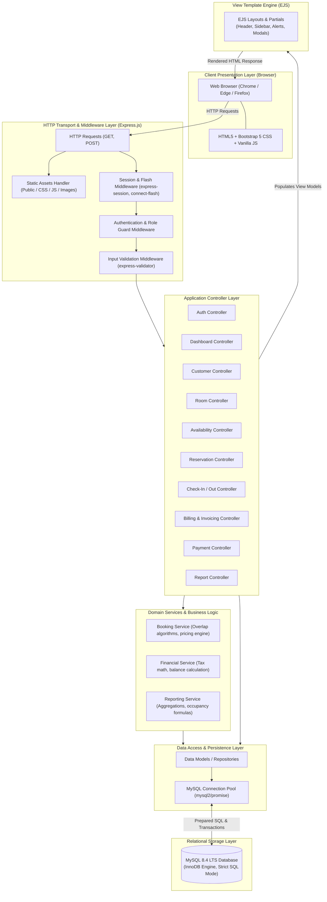
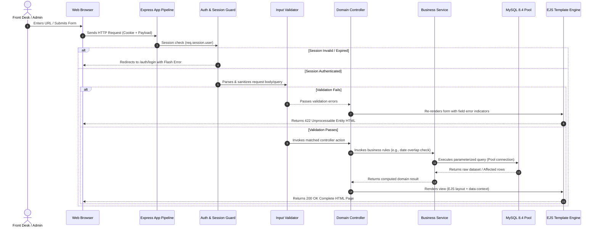
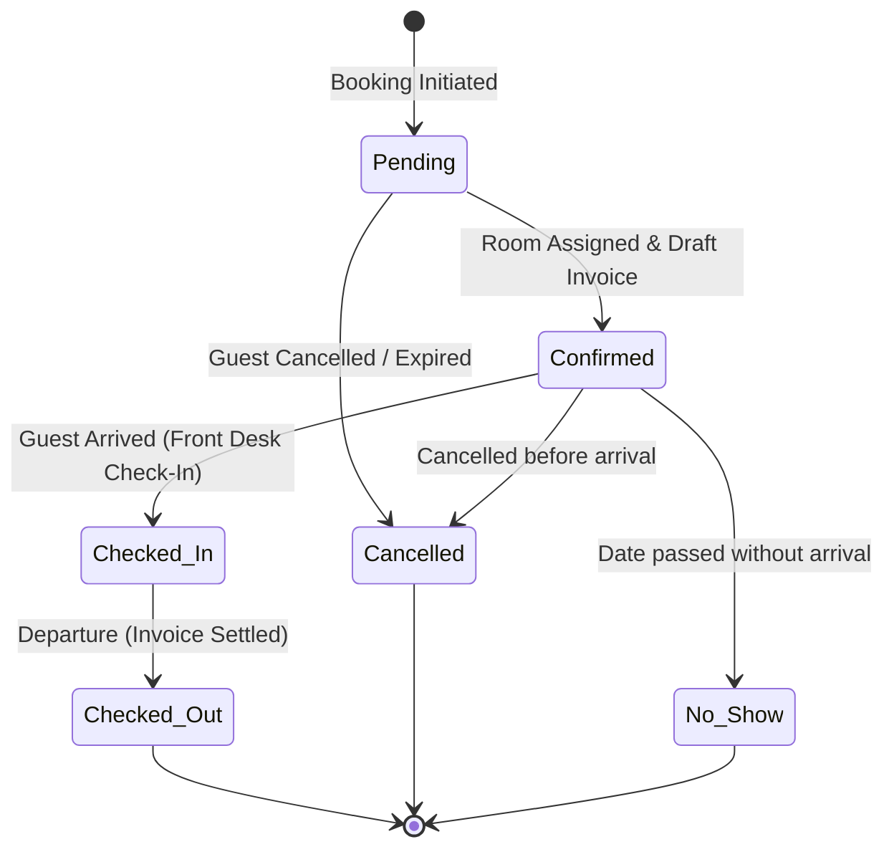
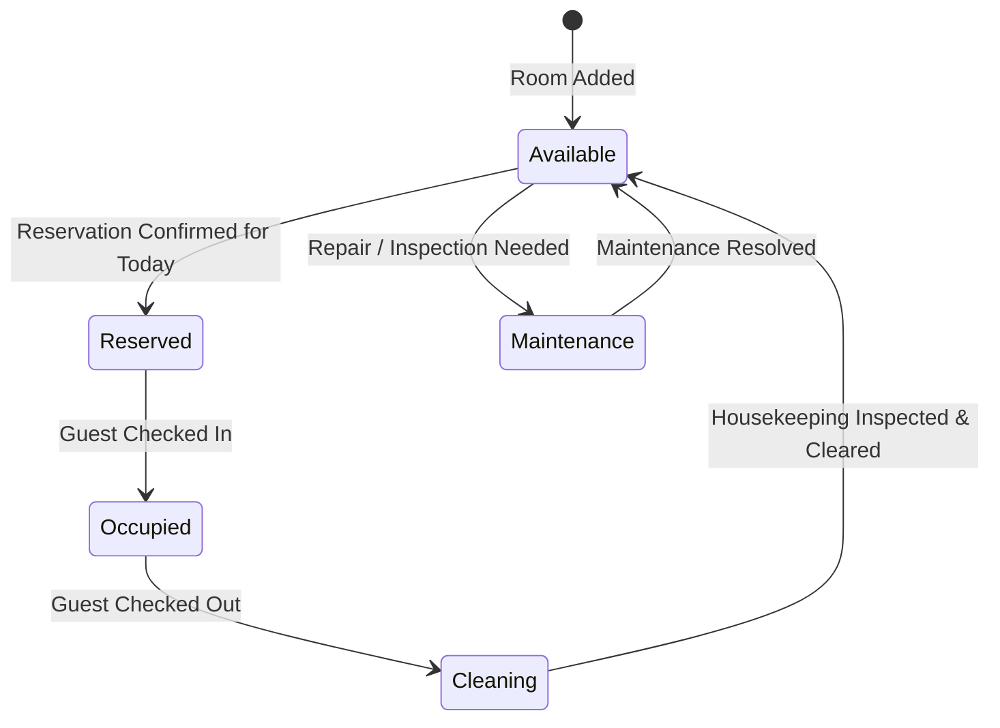
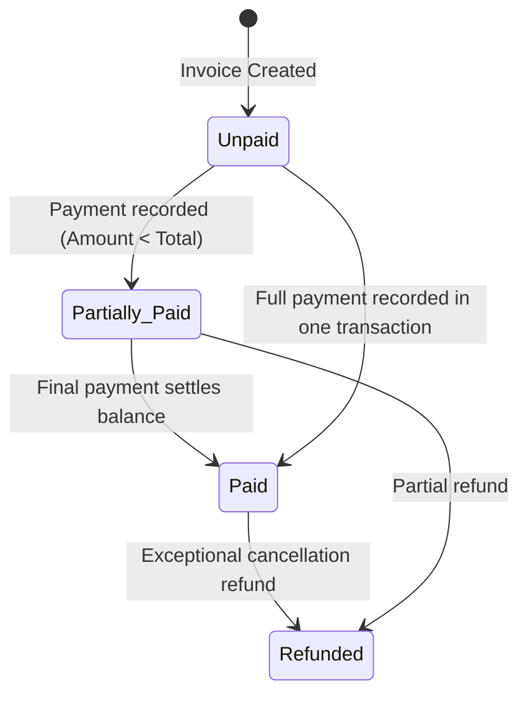

# System Architecture: Hotel Reservation & Management System (HRMS)

**Project Name:** Hotel Reservation & Management System (HRMS)  
**Architecture Style:** Layered Model-View-Controller (MVC) with Service Layer  
**Target Platform:** Node.js (v20+ LTS) / Express.js  
**Database:** MySQL 8.4 LTS via `mysql2/promise`  
**Presentation:** Server-Side Rendered (SSR) HTML5 / EJS / Bootstrap 5  

---

## 1. Architectural Philosophy & Principles

HRMS is engineered using an established, enterprise-proven **Layered MVC Architecture**. For an academic Master of Computer Applications (MCA) capstone, clarity, maintainability, separation of concerns, and robust data integrity take precedence over over-engineered microservices or client-side single-page applications.

### Key Architectural Tenets
1. **Separation of Concerns (SoC):** Routing logic, HTTP transport handling, business rules, SQL querying, and HTML rendering reside in dedicated, non-overlapping software layers.
2. **Server-Side Rendering (SSR):** Complete HTML documents are rendered server-side using EJS templates. This minimizes client-side script overhead, guarantees fast initial paint, and ensures predictable state management.
3. **Database-Driven Data Integrity:** Critical business constraints (uniqueness, referential actions, valid status enumerations) are guaranteed at the database engine level (InnoDB) as well as the application validation layer.
4. **Zero-Trust Parameterized Queries:** Every database interaction is executed via prepared statements using `mysql2/promise` parameterized syntax, preventing SQL Injection by design.
5. **Atomic Financial & Scheduling Operations:** Booking creation, check-out reconciliation, and invoice payment updates utilize explicit database transactions (`START TRANSACTION`, `COMMIT`, `ROLLBACK`).

---

## 2. High-Level System Architecture Diagram



---

## 3. Request-Response Lifecycle Flow

Each client interaction follows a deterministic sequential lifecycle through the Express execution pipeline:



---

## 4. Application Module Breakdown

The system is decomposed into **10 cohesive, loosely coupled functional modules**:

| # | Module Name | Primary Responsibility | Key Files Involved |
| :--- | :--- | :--- | :--- |
| **01** | **Authentication & Session** | Administrator credentials verification, session creation, logout, password hashing, route authorization guards. | `controllers/authController.js`<br>`middlewares/authMiddleware.js`<br>`models/userModel.js` |
| **02** | **Dashboard & KPI Engine** | Real-time aggregation of room metrics, today's arrivals/departures, 30-day occupancy and revenue trend data. | `controllers/dashboardController.js`<br>`services/dashboardService.js`<br>`views/dashboard/index.ejs` |
| **03** | **Customer Registry** | Comprehensive guest profile management, government identity proof storage, guest search, and past booking history. | `controllers/customerController.js`<br>`models/customerModel.js`<br>`views/customers/*` |
| **04** | **Room & Amenity Master** | Physical room inventory, room types, pricing configuration, amenities categorization, maintenance/cleaning state tracking. | `controllers/roomController.js`<br>`models/roomModel.js`<br>`models/roomTypeModel.js` |
| **05** | **Availability Engine** | Conflict-free room discovery given arrival and departure dates; mathematical date-range overlap evaluation. | `controllers/availabilityController.js`<br>`services/availabilityService.js` |
| **06** | **Reservation Management** | Booking lifecycle workflow (`pending` -> `confirmed` -> `cancelled`), booking reference generation, guest and room binding. | `controllers/reservationController.js`<br>`services/bookingService.js`<br>`models/reservationModel.js` |
| **07** | **Check-In & Check-Out** | Front-desk operations: validating guest arrival, recording check-in timestamps, initiating room status changes, handling departure. | `controllers/checkInOutController.js`<br>`services/checkInOutService.js` |
| **08** | **Billing & Invoicing** | Automated invoice generation, multi-item charges (room tariff, services, damage, tax calculations), print-ready invoice layout. | `controllers/billingController.js`<br>`services/billingService.js`<br>`models/invoiceModel.js` |
| **09** | **Payment Processing** | Payment transaction recording (Cash, Card, UPI, Bank Transfer), partial payment tracking, receipt generation, balance updating. | `controllers/paymentController.js`<br>`models/paymentModel.js` |
| **10** | **Reporting & Analytics** | Historical data filtering, revenue by payment mode, occupancy rate calculation, printable and exportable reports. | `controllers/reportController.js`<br>`services/reportService.js`<br>`views/reports/*` |

---

## 5. Comprehensive Route Catalog

### 5.1 Authentication Routes (`/auth`)
| Method | Route | Controller Method | Access | Description |
| :--- | :--- | :--- | :--- | :--- |
| `GET` | `/auth/login` | `authController.showLogin` | Public | Renders administrator login form. |
| `POST` | `/auth/login` | `authController.processLogin` | Public | Authenticates credentials, sets session cookie. |
| `POST` | `/auth/logout` | `authController.logout` | Authenticated | Clears session, redirects to login with flash notice. |

### 5.2 Dashboard Routes (`/dashboard`)
| Method | Route | Controller Method | Access | Description |
| :--- | :--- | :--- | :--- | :--- |
| `GET` | `/dashboard` | `dashboardController.index` | Authenticated | Displays KPI metrics, operational queues, and charts. |

### 5.3 Customer Management Routes (`/customers`)
| Method | Route | Controller Method | Access | Description |
| :--- | :--- | :--- | :--- | :--- |
| `GET` | `/customers` | `customerController.index` | Authenticated | List all customers with pagination and search. |
| `GET` | `/customers/create` | `customerController.create` | Authenticated | Render new customer registration form. |
| `POST` | `/customers` | `customerController.store` | Authenticated | Validate and save new customer record. |
| `GET` | `/customers/:id` | `customerController.show` | Authenticated | View customer details, identity proof, and booking history. |
| `GET` | `/customers/:id/edit` | `customerController.edit` | Authenticated | Render edit customer profile form. |
| `POST` | `/customers/:id/update` | `customerController.update` | Authenticated | Validate and persist updated customer profile. |
| `POST` | `/customers/:id/delete` | `customerController.destroy` | Admin Only | Delete or deactivate customer (if no active bookings). |

### 5.4 Room & Room Type Routes (`/rooms` & `/room-types`)
| Method | Route | Controller Method | Access | Description |
| :--- | :--- | :--- | :--- | :--- |
| `GET` | `/rooms` | `roomController.index` | Authenticated | List all rooms with filter by type and status. |
| `GET` | `/rooms/create` | `roomController.create` | Authenticated | Render new room registration form. |
| `POST` | `/rooms` | `roomController.store` | Authenticated | Validate and insert new physical room. |
| `GET` | `/rooms/:id/edit` | `roomController.edit` | Authenticated | Render room edit form. |
| `POST` | `/rooms/:id/update` | `roomController.update` | Authenticated | Update room details, floor, or status. |
| `POST` | `/rooms/:id/status` | `roomController.updateStatus` | Authenticated | Quick status update (cleaning -> available, etc.). |
| `GET` | `/room-types` | `roomController.typeIndex` | Authenticated | List room categories, base rates, capacities. |
| `POST` | `/room-types` | `roomController.typeStore` | Admin Only | Create new room category. |
| `POST` | `/room-types/:id/update`| `roomController.typeUpdate`| Admin Only | Modify category rates or amenities. |

### 5.5 Availability Checking Routes (`/availability`)
| Method | Route | Controller Method | Access | Description |
| :--- | :--- | :--- | :--- | :--- |
| `GET` | `/availability` | `availabilityController.index` | Authenticated | Render room availability search portal. |
| `POST` | `/availability/search` | `availabilityController.search` | Authenticated | Query available rooms between arrival & departure dates. |

### 5.6 Reservation Management Routes (`/reservations`)
| Method | Route | Controller Method | Access | Description |
| :--- | :--- | :--- | :--- | :--- |
| `GET` | `/reservations` | `reservationController.index` | Authenticated | Tabular view of all reservations with status filters. |
| `GET` | `/reservations/create` | `reservationController.create` | Authenticated | Multi-step booking form (pre-fillable with room/dates). |
| `POST` | `/reservations` | `reservationController.store` | Authenticated | Lock room, create reservation record & draft invoice. |
| `GET` | `/reservations/:id` | `reservationController.show` | Authenticated | Detailed booking itinerary, guest data, billing summary. |
| `GET` | `/reservations/:id/edit` | `reservationController.edit` | Authenticated | Modify dates, guest counts, or assigned room. |
| `POST` | `/reservations/:id/update` | `reservationController.update` | Authenticated | Persist modifications after re-verifying availability. |
| `POST` | `/reservations/:id/cancel` | `reservationController.cancel` | Authenticated | Cancel reservation, release room inventory. |

### 5.7 Front-Desk Check-In & Check-Out Routes (`/frontdesk`)
| Method | Route | Controller Method | Access | Description |
| :--- | :--- | :--- | :--- | :--- |
| `GET` | `/frontdesk/arrivals` | `checkInOutController.arrivals` | Authenticated | Operational view for today's scheduled check-ins. |
| `POST` | `/frontdesk/check-in/:id` | `checkInOutController.processCheckIn` | Authenticated | Perform check-in: update room to 'occupied', record time. |
| `GET` | `/frontdesk/departures`| `checkInOutController.departures` | Authenticated | Operational view for today's scheduled check-outs. |
| `POST` | `/frontdesk/check-out/:id`| `checkInOutController.processCheckOut` | Authenticated | Validate settled balance, mark room 'cleaning', check out. |

### 5.8 Billing & Invoicing Routes (`/invoices`)
| Method | Route | Controller Method | Access | Description |
| :--- | :--- | :--- | :--- | :--- |
| `GET` | `/invoices` | `billingController.index` | Authenticated | List all invoices with payment status filters. |
| `GET` | `/invoices/:id` | `billingController.show` | Authenticated | Display printable invoice document. |
| `POST` | `/invoices/:id/items` | `billingController.addItem` | Authenticated | Add itemized charge (e.g. room service, laundry). |
| `GET` | `/invoices/:id/print` | `billingController.printView` | Authenticated | Minimalist clean layout configured for paper/PDF print. |

### 5.9 Payment Processing Routes (`/payments`)
| Method | Route | Controller Method | Access | Description |
| :--- | :--- | :--- | :--- | :--- |
| `GET` | `/payments` | `paymentController.index` | Authenticated | Comprehensive payment transaction log. |
| `POST` | `/payments` | `paymentController.store` | Authenticated | Record payment against invoice, adjust outstanding balance. |
| `GET` | `/payments/:id/receipt` | `paymentController.receipt` | Authenticated | Printable payment receipt voucher. |

### 5.10 Reports & Analytics Routes (`/reports`)
| Method | Route | Controller Method | Access | Description |
| :--- | :--- | :--- | :--- | :--- |
| `GET` | `/reports` | `reportController.index` | Authenticated | Reports central navigation hub. |
| `GET` | `/reports/reservations` | `reportController.reservationReport` | Authenticated | Filtered booking report with totals. |
| `GET` | `/reports/revenue` | `reportController.revenueReport` | Authenticated | Revenue breakdown by date and payment channel. |
| `GET` | `/reports/occupancy` | `reportController.occupancyReport` | Authenticated | Room utilization percentage by room type. |
| `GET` | `/reports/export-csv` | `reportController.exportCSV` | Authenticated | Stream CSV download of selected dataset. |

---

## 6. Security Architecture & Threat Mitigation

```
Threat Model & Mitigation Matrix
├── 1. SQL Injection (SQLi)
│   ├── Threat: Malicious input crafted into SQL query strings (e.g. ' OR 1=1 --).
│   └── Defense: 100% prepared statements via mysql2/promise parameterized syntax (? placeholders).
│                Zero dynamic string concatenation in SQL clauses.
│
├── 2. Broken Authentication & Session Hijacking
│   ├── Threat: Credential bruteforce, session token theft.
│   └── Defense: Strong password hashing via bcrypt (10 rounds);
│                Session cookies marked httpOnly=true, sameSite='lax';
│                Session regeneration upon successful login.
│
├── 3. Cross-Site Scripting (XSS)
│   ├── Threat: Injecting malicious scripts into guest names, notes, or reviews.
│   └── Defense: EJS automatic HTML entity encoding by default (<%= escape %> vs <%- unescaped %>);
│                Strict input sanitization via express-validator.
│
├── 4. Business Logic: Double Booking & Race Conditions
│   ├── Threat: Two receptionists simultaneously booking Room 101 for the same dates.
│   └── Defense: Database transactions with SELECT ... FOR UPDATE or serializable check queries;
│                Date overlap constraint evaluated within atomic transaction.
│
└── 5. Broken Access Control
    ├── Threat: Direct URL manipulation to access unauthorized endpoints.
    └── Defense: Centralized ensureAuthenticated middleware applied uniformly to all /admin,
                 /dashboard, /reservations, /rooms, /invoices, and /reports routes.
```

---

## 7. State Machine & Lifecycle Transitions

### 7.1 Reservation Status State Machine


### 7.2 Physical Room Status State Machine


### 7.3 Invoice Payment Status State Machine


---

## 8. Suggested Project Folder Structure

The application follows a clean, modular, and maintainable MVC directory tree structure:

```
hotel-management-app/
├── config/                         # Environment & Database Configuration
│   ├── database.js                 # MySQL2 connection pool setup & health check
│   ├── constants.js                # System constants (roles, statuses, tax rates)
│   └── session.js                  # Session store configuration
│
├── controllers/                    # MVC Controllers (HTTP orchestration)
│   ├── authController.js           # Admin login, logout, password change
│   ├── dashboardController.js      # KPI aggregation & chart data
│   ├── customerController.js       # Customer profile CRUD & history
│   ├── roomController.js           # Room inventory & room types CRUD
│   ├── availabilityController.js   # Availability search logic
│   ├── reservationController.js    # Reservation lifecycle handling
│   ├── checkInOutController.js     # Front desk arrival/departure processing
│   ├── billingController.js        # Invoicing, itemization, print views
│   ├── paymentController.js        # Payment recording & receipt creation
│   └── reportController.js         # Financial, occupancy & booking reporting
│
├── database/                       # Database Migration & Seed Scripts
│   ├── schema.sql                  # Complete MySQL 8.4 DDL script (tables, FKs, indexes)
│   └── seeds.sql                   # Initial seed data (default admin, room types, sample rooms)
│
├── middlewares/                    # Custom Express Middlewares
│   ├── authMiddleware.js           # Session verification & role guards
│   ├── validationMiddleware.js     # Request body validation rules
│   ├── errorMiddleware.js          # Centralized error handler & 404 handler
│   └── localsMiddleware.js         # Injects session user & flash messages into EJS
│
├── models/                         # Data Access Objects (SQL queries via mysql2)
│   ├── userModel.js                # Admin user authentication queries
│   ├── customerModel.js            # Guest database operations
│   ├── roomModel.js                # Room & Room Type queries
│   ├── reservationModel.js         # Booking records & status queries
│   ├── invoiceModel.js             # Invoice & invoice items queries
│   └── paymentModel.js             # Payment recording & ledger queries
│
├── services/                       # Reusable Domain & Business Logic
│   ├── availabilityService.js      # Date overlap calculation algorithm
│   ├── billingService.js           # Line-item calculation, taxes & discounts
│   └── reportService.js            # Data aggregation for charts & tables
│
├── public/                         # Public Static Assets
│   ├── css/
│   │   ├── style.css               # Custom theme enhancements
│   │   └── print.css               # Clean print styles for invoices/reports
│   ├── js/
│   │   ├── main.js                 # UI interactions, flash auto-dismiss, modals
│   │   └── chart-config.js         # Dashboard analytics charts (Chart.js via CDN)
│   └── images/
│       ├── logo.png                # Hotel brand logo
│       └── avatar-default.png      # Default user avatar
│
├── views/                          # EJS View Templates
│   ├── layouts/
│   │   ├── header.ejs              # HTML head, Bootstrap 5 CSS, meta tags
│   │   ├── navbar.ejs              # Top navigation bar with user profile & alerts
│   │   ├── sidebar.ejs             # Collapsible admin navigation menu
│   │   ├── footer.ejs              # Footers, JavaScript bundle tags
│   │   └── main.ejs                # Base template wrapper
│   ├── partials/
│   │   ├── alerts.ejs              # Bootstrap flash alerts (success, error, warning)
│   │   └── pagination.ejs          # Reusable pagination links
│   ├── auth/
│   │   └── login.ejs               # Modern admin login page
│   ├── dashboard/
│   │   └── index.ejs               # Main KPI dashboard with stats & quick queues
│   ├── customers/
│   │   ├── index.ejs               # Customer listing & search
│   │   ├── create.ejs              # Add customer form
│   │   ├── edit.ejs                # Edit customer form
│   │   └── show.ejs                # Customer detail & reservation history
│   ├── rooms/
│   │   ├── index.ejs               # Room inventory cards & table
│   │   ├── create.ejs              # Add new room
│   │   ├── edit.ejs                # Edit room
│   │   └── types.ejs               # Room categories and pricing
│   ├── availability/
│   │   └── index.ejs               # Date range availability search portal
│   ├── reservations/
│   │   ├── index.ejs               # Reservation roster with status tabs
│   │   ├── create.ejs              # New reservation booking form
│   │   ├── edit.ejs                # Edit reservation dates/room
│   │   └── show.ejs                # Detailed reservation folio
│   ├── checkin-checkout/
│   │   ├── arrivals.ejs            # Today's check-in management
│   │   └── departures.ejs          # Today's check-out management
│   ├── billing/
│   │   ├── index.ejs               # Invoices list
│   │   ├── show.ejs                # Invoice details & payment modal
│   │   └── print.ejs               # Dedicated printable invoice layout
│   ├── payments/
│   │   ├── index.ejs               # Payments ledger
│   │   └── receipt.ejs             # Printable payment receipt
│   ├── reports/
│   │   ├── index.ejs               # Reports hub
│   │   ├── reservations.ejs        # Reservation report with filters
│   │   ├── revenue.ejs             # Financial & revenue report
│   │   └── occupancy.ejs           # Room occupancy analysis
│   └── errors/
│       ├── 404.ejs                 # Page Not Found error page
│       └── 500.ejs                 # Internal Server Error page
│
├── docs/                           # Architecture & Academic Documentation
│   ├── PROJECT_PLAN.md
│   ├── ARCHITECTURE.md
│   ├── DATABASE_DESIGN.md
│   ├── ER_DIAGRAM.md
│   └── DEVELOPMENT_ROADMAP.md
│
├── .env.example                    # Environment variables template
├── .gitignore                      # Git ignore file (node_modules, .env)
├── package.json                    # Project dependencies & scripts
├── README.md                       # Comprehensive setup guide
└── server.js                       # Application entry point
```

