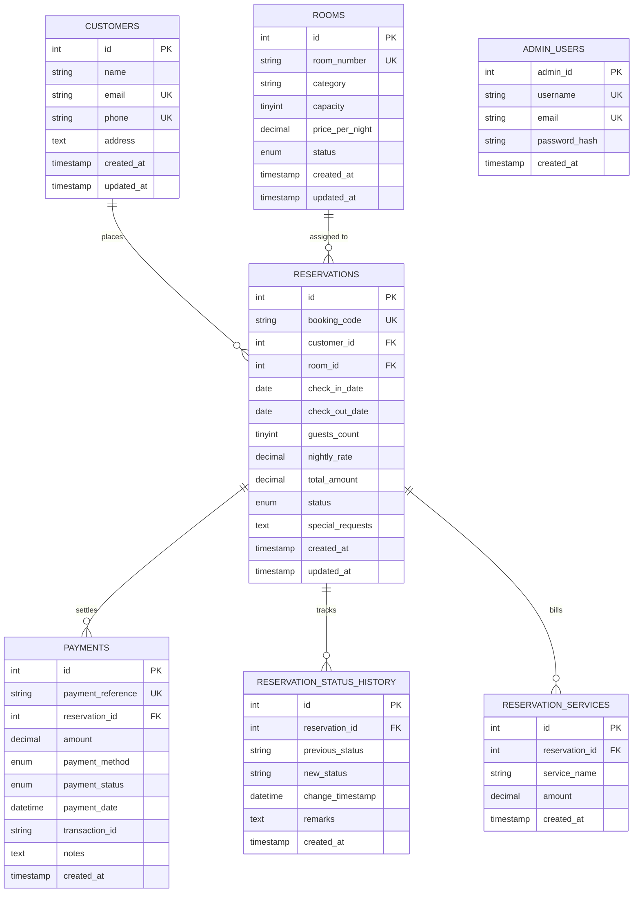

# Hotel Reservation & Management System (HRMS) — MySQL Database Documentation

> **Database System:** MySQL 8.4 LTS  
> **Storage Engine:** InnoDB (ACID Compliant)  
> **Default Collation:** `utf8mb4_unicode_ci`  
> **Normalization Level:** Third Normal Form (3NF)

---

## 📋 Table of Contents
1. [Relational Architecture Overview](#1-relational-architecture-overview)
2. [Data Dictionary & Table Schemas](#2-data-dictionary--table-schemas)
   - [2.1 Table: `customers`](#21-table-customers)
   - [2.2 Table: `rooms`](#22-table-rooms)
   - [2.3 Table: `reservations`](#23-table-reservations)
   - [2.4 Table: `payments`](#24-table-payments)
   - [2.5 Table: `reservation_status_history`](#25-table-reservation_status_history)
   - [2.6 Table: `reservation_services`](#26-table-reservation_services)
   - [2.7 Table: `admin_users`](#27-table-admin_users)
3. [Foreign Keys & Referential Integrity](#3-foreign-keys--referential-integrity)
4. [Indexes & Performance Optimizations](#4-indexes--performance-optimizations)
5. [Stored Routines & Triggers](#5-stored-routines--triggers)
6. [Concurrency Control & ACID Transactions](#6-concurrency-control--acid-transactions)

---

## 1. Relational Architecture Overview

The database design strictly models the operational domains of a luxury hotel: customer identity, physical room inventory, transactional bookings, itemized billing folios, and administrative access control.



---

## 2. Data Dictionary & Table Schemas

### 2.1 Table: `customers`
Stores primary profile information for hotel guests.

| Column | Type | Nullable | Key | Default | Description |
| :--- | :--- | :---: | :---: | :--- | :--- |
| `id` | `INT UNSIGNED` | No | **PK** | `AUTO_INCREMENT` | Unique customer surrogate identifier |
| `name` | `VARCHAR(100)` | No | — | None | Full legal name of guest |
| `email` | `VARCHAR(100)` | No | **UK** | None | Unique contact email address |
| `phone` | `VARCHAR(20)` | No | **UK** | None | Unique primary telephone number |
| `address` | `TEXT` | Yes | — | `NULL` | Residential / billing address |
| `created_at` | `TIMESTAMP` | No | — | `CURRENT_TIMESTAMP` | Account registration timestamp |
| `updated_at` | `TIMESTAMP` | No | — | `CURRENT_TIMESTAMP ON UPDATE` | Last profile modification timestamp |

---

### 2.2 Table: `rooms`
Physical room inventory, capacity limits, nightly tariffs, and operational states.

| Column | Type | Nullable | Key | Default | Description |
| :--- | :--- | :---: | :---: | :--- | :--- |
| `id` | `INT UNSIGNED` | No | **PK** | `AUTO_INCREMENT` | Physical room surrogate identifier |
| `room_number` | `VARCHAR(10)` | No | **UK** | None | Physical room number (e.g. `101`, `PH-01`) |
| `category` | `VARCHAR(50)` | No | — | None | Category: Standard, Deluxe, Premium, Suite |
| `capacity` | `TINYINT UNSIGNED`| No | — | `2` | Maximum guest occupancy (Check: `>= 1`) |
| `price_per_night`| `DECIMAL(10,2)` | No | — | None | Base nightly tariff in INR (Check: `>= 0.00`) |
| `status` | `ENUM` | No | — | `'ACTIVE'` | Operational status: `ACTIVE`, `MAINTENANCE` |
| `created_at` | `TIMESTAMP` | No | — | `CURRENT_TIMESTAMP` | Room record creation timestamp |
| `updated_at` | `TIMESTAMP` | No | — | `CURRENT_TIMESTAMP ON UPDATE` | Last status/pricing update timestamp |

---

### 2.3 Table: `reservations`
Transactional room bookings linking customers and rooms with immutable price snapshots.

| Column | Type | Nullable | Key | Default | Description |
| :--- | :--- | :---: | :---: | :--- | :--- |
| `id` | `INT UNSIGNED` | No | **PK** | `AUTO_INCREMENT` | Reservation transaction identifier |
| `booking_code` | `VARCHAR(30)` | No | **UK** | None | Human-readable ID (`RES-YYYYMMDD-XXXX`) |
| `customer_id` | `INT UNSIGNED` | No | **FK** | None | References `customers(id)` |
| `room_id` | `INT UNSIGNED` | No | **FK** | None | References `rooms(id)` |
| `check_in_date` | `DATE` | No | — | None | Scheduled arrival date |
| `check_out_date`| `DATE` | No | — | None | Scheduled departure date |
| `guests_count` | `TINYINT UNSIGNED`| No | — | `1` | Number of staying guests (Check: `>= 1`) |
| `nightly_rate` | `DECIMAL(10,2)` | No | — | None | Price snapshot at time of reservation |
| `total_amount` | `DECIMAL(10,2)` | No | — | None | Total room charge (Nights * Rate) |
| `status` | `ENUM` | No | — | `'confirmed'` | `pending`, `confirmed`, `checked_in`, `checked_out`, `cancelled` |
| `special_requests`| `TEXT` | Yes | — | `NULL` | Optional guest notes and amenities |
| `created_at` | `TIMESTAMP` | No | — | `CURRENT_TIMESTAMP` | Booking timestamp |
| `updated_at` | `TIMESTAMP` | No | — | `CURRENT_TIMESTAMP ON UPDATE` | Last booking status update timestamp |

---

### 2.4 Table: `payments`
Itemized payment transactions and settlement audit logs.

| Column | Type | Nullable | Key | Default | Description |
| :--- | :--- | :---: | :---: | :--- | :--- |
| `id` | `INT UNSIGNED` | No | **PK** | `AUTO_INCREMENT` | Payment record identifier |
| `payment_reference`| `VARCHAR(30)` | No | **UK** | None | Unique receipt reference (`PAY-YYYYMMDD-XXXX`) |
| `reservation_id` | `INT UNSIGNED` | No | **FK** | None | Associated reservation folio |
| `amount` | `DECIMAL(10,2)` | No | — | None | Settled amount in INR (Check: `> 0.00`) |
| `payment_method` | `ENUM` | No | — | `'CASH'` | Instrument: `CASH`, `UPI`, `CARD` |
| `payment_status` | `ENUM` | No | — | `'SUCCESS'` | Status: `SUCCESS`, `PENDING`, `FAILED` |
| `payment_date` | `DATETIME` | No | — | `CURRENT_TIMESTAMP` | Exact transaction timestamp |
| `transaction_id`| `VARCHAR(100)` | Yes | — | `NULL` | External gateway transaction/UTR number |
| `notes` | `TEXT` | Yes | — | `NULL` | Settlement remarks |
| `created_at` | `TIMESTAMP` | No | — | `CURRENT_TIMESTAMP` | Record creation timestamp |

---

### 2.5 Table: `reservation_status_history`
Audit ledger tracking all lifecycle transitions for every reservation.

| Column | Type | Nullable | Key | Default | Description |
| :--- | :--- | :---: | :---: | :--- | :--- |
| `id` | `INT UNSIGNED` | No | **PK** | `AUTO_INCREMENT` | Audit log record ID |
| `reservation_id` | `INT UNSIGNED` | No | **FK** | None | Target reservation ID |
| `previous_status`| `VARCHAR(30)` | Yes | — | `NULL` | Pre-transition status |
| `new_status` | `VARCHAR(30)` | No | — | None | Post-transition status |
| `change_timestamp`| `DATETIME` | No | — | `CURRENT_TIMESTAMP` | Transition timestamp |
| `remarks` | `TEXT` | Yes | — | `NULL` | Operational notes / cancellation rationale |
| `created_at` | `TIMESTAMP` | No | — | `CURRENT_TIMESTAMP` | Audit insertion timestamp |

---

### 2.6 Table: `reservation_services`
Itemized incidentals and additional services added to guest folios.

| Column | Type | Nullable | Key | Default | Description |
| :--- | :--- | :---: | :---: | :--- | :--- |
| `id` | `INT UNSIGNED` | No | **PK** | `AUTO_INCREMENT` | Incidental item ID |
| `reservation_id` | `INT UNSIGNED` | No | **FK** | None | Associated reservation folio |
| `service_name` | `VARCHAR(100)` | No | — | None | Description (e.g. Laundry, Shuttle) |
| `amount` | `DECIMAL(10,2)` | No | — | None | Charge in INR (Check: `>= 0.00`) |
| `created_at` | `TIMESTAMP` | No | — | `CURRENT_TIMESTAMP` | Timestamp charge was added |

---

### 2.7 Table: `admin_users`
Administrator accounts with bcrypt salted password hashes.

| Column | Type | Nullable | Key | Default | Description |
| :--- | :--- | :---: | :---: | :--- | :--- |
| `admin_id` | `INT UNSIGNED` | No | **PK** | `AUTO_INCREMENT` | Administrator user ID |
| `username` | `VARCHAR(50)` | No | **UK** | None | Login handle |
| `email` | `VARCHAR(100)` | No | **UK** | None | Official administrator email address |
| `password_hash`| `VARCHAR(255)` | No | — | None | 10-round salted bcrypt hash |
| `created_at` | `TIMESTAMP` | No | — | `CURRENT_TIMESTAMP` | Provisioning timestamp |

---

## 3. Foreign Keys & Referential Integrity

| Constraint Name | Child Table | Foreign Key Column | Parent Table | On Delete | On Update | Rationale |
| :--- | :--- | :--- | :--- | :---: | :---: | :--- |
| `fk_reservations_customer` | `reservations` | `customer_id` | `customers(id)` | **RESTRICT** | **CASCADE** | Prevents accidental deletion of customers with booking records. |
| `fk_reservations_room` | `reservations` | `room_id` | `rooms(id)` | **RESTRICT** | **CASCADE** | Prevents deletion of physical rooms with reservation history. |
| `fk_payments_reservation` | `payments` | `reservation_id` | `reservations(id)` | **RESTRICT** | **CASCADE** | Protects financial audit trail; reservations with payments cannot vanish. |
| `fk_rsh_reservation` | `reservation_status_history` | `reservation_id` | `reservations(id)` | **CASCADE** | **CASCADE** | Audit history cascades if reservation is expunged. |
| `fk_services_reservation`| `reservation_services` | `reservation_id` | `reservations(id)` | **CASCADE** | **CASCADE** | Folio incidentals cascade with reservation. |

---

## 4. Indexes & Performance Optimizations

1. **`idx_customers_name`**: B-Tree index on `customers(name)` for customer search optimization.
2. **`idx_rooms_status` & `idx_rooms_category`**: Indexes for rapid room filtering by category and operational readiness.
3. **`idx_reservations_dates`**: Composite index on `reservations(check_in_date, check_out_date)` for room availability evaluation.
4. **`idx_reservations_status`**: B-Tree index on `reservations(status)` for filtering out cancelled/completed bookings during overlap scans.
5. **`idx_payments_date` & `idx_payments_status`**: Indexes accelerating revenue reporting aggregations across months and years.

---

## 5. Stored Routines & Triggers

### 5.1 Stored Function: `fn_calculate_stay_duration`
```sql
CREATE FUNCTION `fn_calculate_stay_duration`(p_check_in DATE, p_check_out DATE)
RETURNS INT
DETERMINISTIC
READS SQL DATA
BEGIN
  RETURN GREATEST(1, DATEDIFF(p_check_out, p_check_in));
END;
```

### 5.2 Stored Procedure: `sp_get_room_availability`
```sql
CREATE PROCEDURE `sp_get_room_availability`(
  IN p_check_in DATE,
  IN p_check_out DATE,
  IN p_guests INT
)
BEGIN
  SELECT r.id, r.room_number, r.category, r.capacity, r.price_per_night, r.status
  FROM rooms r
  WHERE r.status = 'ACTIVE'
    AND r.capacity >= COALESCE(p_guests, 1)
    AND r.id NOT IN (
      SELECT res.room_id
      FROM reservations res
      WHERE res.status IN ('pending', 'confirmed', 'checked_in')
        AND res.check_in_date < p_check_out
        AND res.check_out_date > p_check_in
    )
  ORDER BY r.category ASC, r.room_number ASC;
END;
```

### 5.3 Audit Trigger: `trg_reservations_status_audit`
```sql
CREATE TRIGGER `trg_reservations_status_audit`
AFTER UPDATE ON `reservations`
FOR EACH ROW
BEGIN
  IF OLD.status != NEW.status THEN
    INSERT INTO `reservation_status_history`
      (`reservation_id`, `previous_status`, `new_status`, `change_timestamp`, `remarks`)
    VALUES
      (NEW.id, OLD.status, NEW.status, NOW(), CONCAT('Automated trigger: Status changed from ', OLD.status, ' to ', NEW.status));
  END IF;
END;
```

---

## 6. Concurrency Control & ACID Transactions

The system eliminates race conditions through **InnoDB Row-Level Locking**:
```sql
-- 1. Begin atomic transaction
START TRANSACTION;

-- 2. Lock the room row exclusively
SELECT id, room_number, price_per_night FROM rooms WHERE id = ? FOR UPDATE;

-- 3. Scan for overlapping active bookings under the active row lock
SELECT id FROM reservations 
WHERE room_id = ? 
  AND status IN ('pending', 'confirmed', 'checked_in')
  AND check_in_date < ? 
  AND check_out_date > ?;

-- 4. Insert booking if zero conflicts exist
INSERT INTO reservations (...) VALUES (...);

-- 5. Commit transaction and release locks
COMMIT;
```
If an error or conflict occurs at any point, `connection.rollback()` is executed and the connection is guaranteed to be released back to the pool in a `finally` block.
