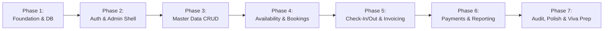

# Development Roadmap: Hotel Reservation & Management System (HRMS)

**Project Stage:** Architecture & Planning Phase (Docs Complete)  
**Methodology:** Incremental Iterative Delivery (Milestone-based)  
**Target Completion:** Academic MCA Capstone Submission  

---

## 1. Phased Milestone Overview

The development lifecycle is divided into **7 discrete, sequential phases**. Each phase contains explicit objectives, technical tasks, deliverables, and verification acceptance criteria.



---

## 2. Detailed Phase Specifications

### Phase 1: Environment Setup, Configuration & Database Foundation
**Goal:** Establish the project runtime, directory structure, database connection pooling, and base application pipeline.

- **Tasks:**
  - Initialize Node.js project (`npm init -y`) and install core dependencies:
    - Runtime: `express`, `ejs`, `express-session`, `mysql2`, `bcryptjs`, `dotenv`, `connect-flash`, `method-override`
    - Validation: `express-validator`
    - Development: `nodemon`
  - Create standard MVC folder hierarchy (`config`, `controllers`, `models`, `middlewares`, `routes`, `services`, `views`, `public`, `database`).
  - Configure `.env` and `config/database.js` with `mysql2/promise` connection pool (`waitForConnections: true, connectionLimit: 10, queueLimit: 0`).
  - Set up `database/schema.sql` and run table creation scripts in MySQL 8.4 LTS.
  - Implement basic Express application pipeline in `server.js` with session, flash messages, static assets routing, and error handler skeleton.
- **Deliverables:**
  - Working Express server responding on `http://localhost:3000`.
  - Verified MySQL connection pool executing test query (`SELECT 1`).
  - Verified schema tables in MySQL Workbench.
- **Verification Gate:**
  - [ ] `npm start` launches without runtime errors.
  - [ ] Terminal logs successful database pool initialization.
  - [ ] All 11 relational tables exist in MySQL with correct keys and foreign constraints.

---

### Phase 2: Authentication, Security Middleware & Admin Shell
**Goal:** Implement secure administrator login, session management, access control guards, and the responsive Bootstrap 5 admin template.

- **Tasks:**
  - Create seed script for default administrator (`database/seeds.sql`) with hashed password (`bcryptjs`).
  - Implement `userModel.js` with parameterized query for user lookup by username or email.
  - Implement `authController.js` (`showLogin`, `processLogin`, `logout`).
  - Build `middlewares/authMiddleware.js` (`ensureAuthenticated`, `ensureAdmin`) and `localsMiddleware.js` to inject `currentUser` and `messages` into EJS.
  - Build master EJS layout partials in `views/layouts/`:
    - `header.ejs`: Responsive Bootstrap 5 CSS, Google Fonts, Bootstrap Icons.
    - `navbar.ejs`: Brand logo, logged-in user profile badge, quick logout trigger.
    - `sidebar.ejs`: Collapsible navigation menu mapping all 10 modules.
    - `footer.ejs`: Copyright, scripts bundle (`bootstrap.bundle.min.js`, custom JS).
    - `partials/alerts.ejs`: Dismissible Bootstrap alerts for success, error, and warning flash notices.
  - Build `views/auth/login.ejs` with clean card layout and validation feedback.
- **Deliverables:**
  - Working authentication flow with session persistence.
  - Protected route guard redirecting unauthenticated traffic to `/auth/login`.
  - Reusable admin UI layout shell rendering across viewports.
- **Verification Gate:**
  - [ ] Logging in with correct credentials opens the dashboard.
  - [ ] Logging in with invalid credentials shows an immediate flash error.
  - [ ] Attempting to access `/dashboard` without an active session redirects to `/auth/login`.
  - [ ] Logging out destroys session and clears cookie.

---

### Phase 3: Master Data Management (Rooms, Room Types, Amenities & Customers)
**Goal:** Build complete CRUD modules for foundational hotel inventories and guest records.

- **Tasks:**
  - **Amenities & Room Types:**
    - Models: `roomTypeModel.js`, `amenityModel.js`.
    - Controllers & Views: Listing, creation form, pricing and capacity updates.
    - Mapping amenities to room types via `room_type_amenities`.
  - **Physical Rooms:**
    - Model: `roomModel.js`.
    - Controllers & Views: Create room (unique room number, floor, category selector), list rooms with status indicators (`available`, `occupied`, `reserved`, `maintenance`, `cleaning`), edit room.
  - **Customer Registry:**
    - Model: `customerModel.js`.
    - Controller & Views: Customer index with search (by name, phone, email), register customer form with server-side validation (`express-validator`), customer detail page displaying booking history.
- **Deliverables:**
  - Functional CRUD interfaces for Room Types, Amenities, Rooms, and Customers.
  - Complete server-side validation rejecting invalid phone numbers, negative room prices, or duplicate entries.
- **Verification Gate:**
  - [ ] Adding a room with an existing room number throws a clean user-facing error.
  - [ ] Customer search filters correctly by partial phone or name query.
  - [ ] Room list displays correct badges corresponding to room operational statuses.

---

### Phase 4: Availability Engine & Reservation Management
**Goal:** Deliver the core booking engine with zero-conflict availability algorithm and multi-step reservation management.

- **Tasks:**
  - **Availability Service (`services/availabilityService.js`):**
    - Implement parameterized overlap detection SQL query:
      ```sql
      SELECT r.*, rt.name AS type_name, rt.base_price_per_night, rt.max_occupancy_adults
      FROM rooms r
      JOIN room_types rt ON r.room_type_id = rt.id
      WHERE r.status != 'maintenance'
        AND r.id NOT IN (
          SELECT room_id FROM reservations
          WHERE status IN ('pending', 'confirmed', 'checked_in')
            AND check_in_date < ? AND check_out_date > ?
        );
      ```
  - **Availability Portal:**
    - Search interface allowing date range selection (`check_in_date`, `check_out_date`) and guest headcount.
    - Display of available rooms with "Book Now" deep links pre-filling reservation forms.
  - **Reservation Lifecycle Engine (`controllers/reservationController.js`, `models/reservationModel.js`):**
    - Multi-step booking form linking customer, room, and stay dates.
    - Auto-calculation of total nights and estimated total.
    - Generation of human-readable booking reference (`RES-YYYYMMDD-XXXX`).
    - Reservation roster with status tabs (`All`, `Pending`, `Confirmed`, `Checked-In`, `Completed`, `Cancelled`).
    - Booking modification and cancellation workflows (releasing room inventory).
- **Deliverables:**
  - Real-time room availability checker.
  - Reservation creation workflow with strict double-booking prevention.
  - Detailed reservation itinerary view (`views/reservations/show.ejs`).
- **Verification Gate:**
  - [ ] Searching dates with an existing booking correctly excludes that specific room.
  - [ ] Attempting to book an overlapping date returns a validation error and blocks insertion.
  - [ ] Cancelling a reservation immediately makes the room available for that date range again.

---

### Phase 5: Front Desk Operations (Check-In / Out) & Billing/Invoicing Engine
**Goal:** Facilitate day-to-day front desk guest arrival/departure operations and automated invoice generation.

- **Tasks:**
  - **Front Desk Queues (`controllers/checkInOutController.js`):**
    - Today's Arrivals queue (`check_in_date = CURRENT_DATE` and status = `confirmed`).
    - One-click Check-In action: converts reservation to `checked_in`, updates room to `occupied`, records `actual_check_in` timestamp.
    - Today's Departures queue (`check_out_date = CURRENT_DATE` and status = `checked_in`).
    - One-click Check-Out action: verifies settled balance, marks reservation `checked_out`, sets room status to `cleaning`, records `actual_check_out` timestamp.
  - **Billing & Invoicing Engine (`services/billingService.js`, `models/invoiceModel.js`):**
    - Automatic invoice generation upon reservation booking/check-in.
    - Dynamic line-item billing (`invoice_items`):
      - Base room tariff (nights × rate)
      - Incidental services (room service, laundry, extra bed)
      - Applicable tax calculation (configurable rate, e.g. 12%)
      - Discount deduction
    - Printable invoice template (`views/billing/print.ejs`) styled with `@media print` CSS for paper or PDF generation.
- **Deliverables:**
  - Front-desk arrivals/departures dashboard views.
  - Automated itemized invoice creation and maintenance.
  - Print-ready guest billing folio.
- **Verification Gate:**
  - [ ] Check-in updates physical room status to `occupied` instantly.
  - [ ] Check-out with an unpaid balance triggers a warning alert to front-desk staff.
  - [ ] Printed invoice renders with clean formatting without sidebar or navbar clutter.

---

### Phase 6: Payment Processing & Reporting/Analytics Module
**Goal:** Provide multi-modal payment recording, receipt generation, and comprehensive administrative reports.

- **Tasks:**
  - **Payment Processing (`controllers/paymentController.js`, `models/paymentModel.js`):**
    - Payment recording modal/form on the invoice page.
    - Multi-mode support: `Cash`, `Credit Card`, `Debit Card`, `UPI`, `Bank Transfer`.
    - Auto-calculation of paid amount and outstanding balance on the invoice.
    - Update invoice status: `unpaid` -> `partially_paid` -> `paid`.
    - Printable payment receipt voucher (`views/payments/receipt.ejs`).
  - **Reporting & Business Analytics (`controllers/reportController.js`, `services/reportService.js`):**
    - **Reservation Report:** Filter by date range, room type, status; displays total booking counts and guest volume.
    - **Revenue Report:** Financial ledger grouped by date and payment instrument; totals billed vs collected.
    - **Occupancy Report:** Room utilization rates ($(\text{Occupied Rooms} / \text{Total Rooms}) \times 100$).
    - CSV Export functionality for tabular datasets.
- **Deliverables:**
  - Working payment ledger and receipt generation.
  - Complete analytics and reporting suite with date-range filters and CSV export.
- **Verification Gate:**
  - [ ] Recording a partial payment marks invoice as `partially_paid` and accurately computes remaining balance.
  - [ ] Final payment matching the exact balance marks the invoice as `paid`.
  - [ ] Revenue report accurately reflects the sum of completed payments in the selected interval.

---

### Phase 7: Polish, Academic Documentation, Seed Data & Viva Defense Preparation
**Goal:** Refine system performance, populate rich academic demonstration data, conduct security audits, and prepare viva presentation assets.

- **Tasks:**
  - Populate comprehensive demo seed data:
    - 4 Room Types (Single Standard, Deluxe Double, Executive Suite, Presidential Suite)
    - 15 Physical Rooms across 3 floors
    - 10 Amenities with icons
    - 10 Realistic Customer profiles with Indian/International ID proofs
    - 15 Historical and upcoming reservations across different lifecycle states
    - Associated invoices and payment transactions
  - Final security audit: verify all queries use prepared statements, verify CSRF/XSS escaping in EJS.
  - Optimize UI with Chart.js visualization on the admin dashboard (Monthly Revenue trend, Occupancy breakdown).
  - Compile academic project report documentation, setup guide (`README.md`), and viva defense question-and-answer guide.
- **Deliverables:**
  - Fully populated, turnkey working application with realistic sample data.
  - Complete MCA viva documentation packet.
- **Verification Gate:**
  - [ ] Fresh installation from `schema.sql` and `seeds.sql` boots instantly with full demo data.
  - [ ] Zero unhandled errors across all 10 project requirements.
  - [ ] Clean code adhering to standard MVC best practices.

---

## 3. Academic Defense (Viva Voce) Preparation Summary

For the academic evaluation committee, the following design decisions are documented and defensible:

1. **Why MySQL 8.4 LTS instead of MongoDB?**
   - Hotel reservations represent strict ACID transactional domains where double-bookings and financial balance discrepancies cannot be tolerated. Relational constraints (FKs, CHECKs, Unique keys) guarantee integrity at the engine level.
2. **Why Server-Side Rendering (EJS) instead of React/Vue?**
   - Eliminates redundant client-side state synchronization, reduces architecture complexity, satisfies MCA project requirements cleanly, and provides rapid development with lower bundle overhead.
3. **How is Double Booking Prevented?**
   - Mathematical date interval overlap condition evaluated in a parameterized SQL query within an atomic transaction.
4. **How are SQL Injections Prevented?**
   - Strictly using `mysql2/promise` with prepared statement placeholders (`?`), ensuring no raw SQL string concatenation.

