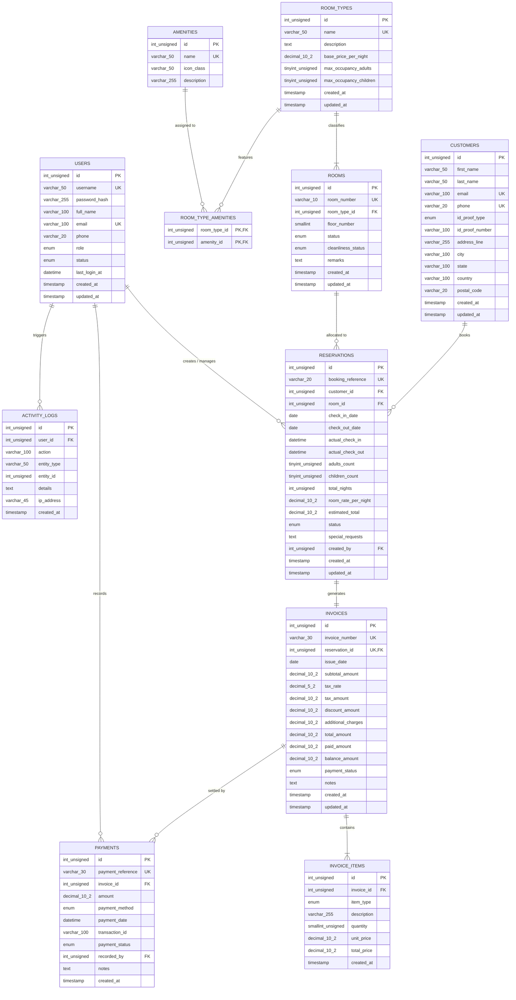

# Entity-Relationship (ER) Diagram Specification: HRMS

**Academic Level:** MCA Capstone Standard  
**Notation:** Crow's Foot Relational Notation  
**Diagram Format:** Mermaid.js `erDiagram`  
**RDBMS Target:** MySQL 8.4 LTS (InnoDB Relational Engine)  

---

## 1. High-Level Relational Model Overview

The database architecture for the **Hotel Reservation & Management System (HRMS)** consists of **11 normalized relational entities** designed to model hospitality transactions, guest histories, room availability state, and multi-line item billing.

### Primary Relationship Cardinalities:
- **Room Type to Rooms:** `1 : N` (One room classification encompasses many physical rooms).
- **Room Type to Amenities:** `M : N` (Resolved via `room_type_amenities` junction entity).
- **Customer to Reservations:** `1 : N` (One registered guest can make multiple lifetime reservations).
- **Room to Reservations:** `1 : N` (One physical room hosts multiple non-overlapping reservations over time).
- **Reservation to Invoice:** `1 : 1` (Each reservation maps deterministically to exactly one billing invoice).
- **Invoice to Invoice Items:** `1 : N` (An invoice contains one or more itemized charges).
- **Invoice to Payments:** `1 : N` (An invoice can be settled via multiple partial or full payment transactions).
- **User to Reservations / Payments / Logs:** `1 : N` (Administrative users create bookings, record payments, and generate audit logs).

---

## 2. Mermaid Entity-Relationship Diagram



---

## 3. Entity-Relationship Cardinality Table

| Entity A (Parent) | Cardinality | Entity B (Child) | Foreign Key Attribute | Relationship Semantics | Cascading Rule |
| :--- | :---: | :--- | :--- | :--- | :--- |
| `room_types` | `1 : N` | `rooms` | `rooms.room_type_id` | Each room belongs to exactly one category; a category has many rooms. | `ON DELETE RESTRICT` |
| `room_types` | `1 : N` | `room_type_amenities`| `room_type_amenities.room_type_id` | Associates categories with multiple amenities. | `ON DELETE CASCADE` |
| `amenities` | `1 : N` | `room_type_amenities`| `room_type_amenities.amenity_id` | Associates individual amenities with categories. | `ON DELETE CASCADE` |
| `customers` | `1 : N` | `reservations` | `reservations.customer_id` | A customer books one or more reservations over time. | `ON DELETE RESTRICT` |
| `rooms` | `1 : N` | `reservations` | `reservations.room_id` | A room is booked across distinct non-overlapping intervals. | `ON DELETE RESTRICT` |
| `users` | `1 : N` | `reservations` | `reservations.created_by` | Tracks which staff member keyed in the reservation. | `ON DELETE SET NULL` |
| `reservations` | `1 : 1` | `invoices` | `invoices.reservation_id` | Each reservation generates exactly one billing folio. | `ON DELETE RESTRICT` |
| `invoices` | `1 : N` | `invoice_items` | `invoice_items.invoice_id` | An invoice has line-item details (room charges, laundry, etc.). | `ON DELETE CASCADE` |
| `invoices` | `1 : N` | `payments` | `payments.invoice_id` | An invoice can be paid in full or across partial payments. | `ON DELETE RESTRICT` |
| `users` | `1 : N` | `payments` | `payments.recorded_by` | Tracks the cashier who accepted the settlement. | `ON DELETE SET NULL` |
| `users` | `1 : N` | `activity_logs` | `activity_logs.user_id` | Tracks operator actions across the entire application. | `ON DELETE SET NULL` |

---

## 4. Relational Schema Representation (Database Notation)

Below is the formal relational schema specification indicating Primary Keys (`PK`) and Foreign Keys (`FK`):

```
USERS (
    id [PK], username, password_hash, full_name, email, phone, role, status, 
    last_login_at, created_at, updated_at
)

ROOM_TYPES (
    id [PK], name, description, base_price_per_night, max_occupancy_adults, 
    max_occupancy_children, created_at, updated_at
)

AMENITIES (
    id [PK], name, icon_class, description
)

ROOM_TYPE_AMENITIES (
    room_type_id [PK, FK -> ROOM_TYPES.id], 
    amenity_id [PK, FK -> AMENITIES.id]
)

ROOMS (
    id [PK], room_number, room_type_id [FK -> ROOM_TYPES.id], floor_number, 
    status, cleanliness_status, remarks, created_at, updated_at
)

CUSTOMERS (
    id [PK], first_name, last_name, email, phone, id_proof_type, id_proof_number, 
    address_line, city, state, country, postal_code, created_at, updated_at
)

RESERVATIONS (
    id [PK], booking_reference, customer_id [FK -> CUSTOMERS.id], 
    room_id [FK -> ROOMS.id], check_in_date, check_out_date, actual_check_in, 
    actual_check_out, adults_count, children_count, total_nights, 
    room_rate_per_night, estimated_total, status, special_requests, 
    created_by [FK -> USERS.id], created_at, updated_at
)

INVOICES (
    id [PK], invoice_number, reservation_id [FK -> RESERVATIONS.id, UNIQUE], 
    issue_date, subtotal_amount, tax_rate, tax_amount, discount_amount, 
    additional_charges, total_amount, paid_amount, balance_amount, 
    payment_status, notes, created_at, updated_at
)

INVOICE_ITEMS (
    id [PK], invoice_id [FK -> INVOICES.id], item_type, description, 
    quantity, unit_price, total_price, created_at
)

PAYMENTS (
    id [PK], payment_reference, invoice_id [FK -> INVOICES.id], amount, 
    payment_method, payment_date, transaction_id, payment_status, 
    recorded_by [FK -> USERS.id], notes, created_at
)

ACTIVITY_LOGS (
    id [PK], user_id [FK -> USERS.id], action, entity_type, entity_id, 
    details, ip_address, created_at
)
```

---

## 5. Relational Business Constraints & Integrity Rules

1. **Chronological Validity Constraint:**
   $$\text{check\_out\_date} > \text{check\_in\_date}$$
   Enforced via SQL `CHECK` constraint: `CONSTRAINT chk_res_dates CHECK (check_out_date > check_in_date)`.

2. **Temporal Overlap Prevention (Zero Double-Booking Guarantee):**
   A room $R$ cannot be allocated to a new reservation with interval $[A_{in}, A_{out}]$ if there exists any active reservation with interval $[B_{in}, B_{out}]$ for room $R$ where:
   $$(B_{in} < A_{out}) \land (B_{out} > A_{in}) \land (\text{status} \in \{\text{'confirmed'}, \text{'checked\_in'}, \text{'pending'}\})$$

3. **Financial Conservation Law (Invoice Calculation):**
   $$\text{subtotal} = \sum (\text{invoice\_items.total\_price})$$
   $$\text{tax\_amount} = \frac{\text{subtotal} \times \text{tax\_rate}}{100}$$
   $$\text{total\_amount} = \text{subtotal} + \text{tax\_amount} + \text{additional\_charges} - \text{discount\_amount}$$
   $$\text{paid\_amount} = \sum (\text{payments.amount where status = 'completed'})$$
   $$\text{balance\_amount} = \text{total\_amount} - \text{paid\_amount}$$

4. **Financial Settlement State Consistency:**
   - If $\text{paid\_amount} = 0 \implies \text{payment\_status} = \text{'unpaid'}$
   - If $0 < \text{paid\_amount} < \text{total\_amount} \implies \text{payment\_status} = \text{'partially\_paid'}$
   - If $\text{paid\_amount} \ge \text{total\_amount} \implies \text{payment\_status} = \text{'paid'}$

