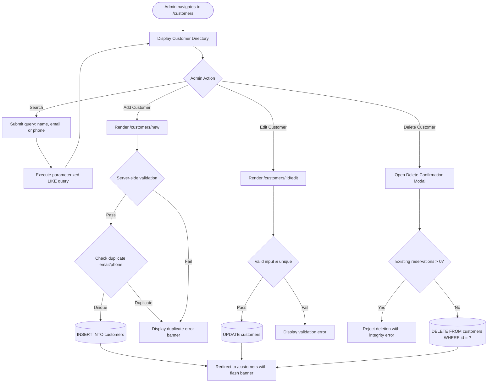
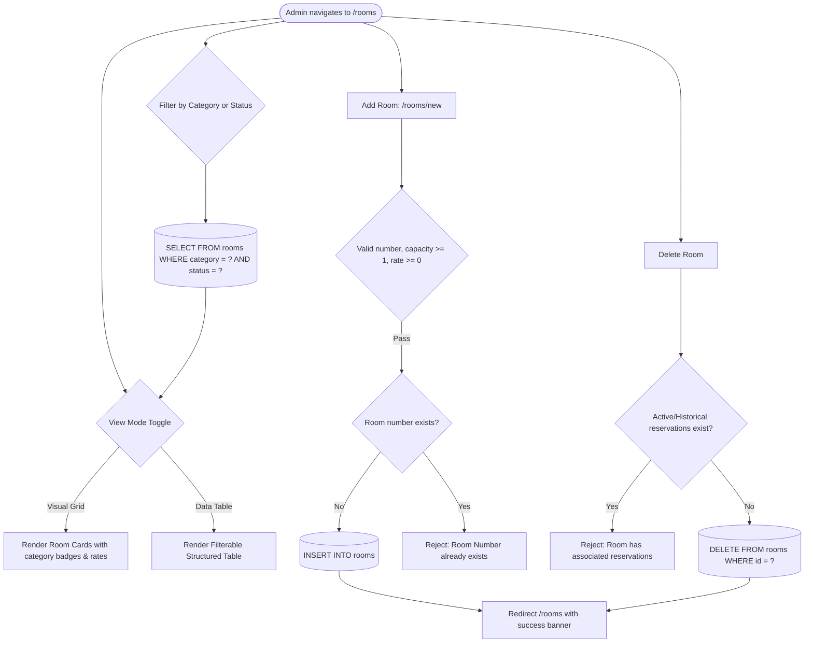
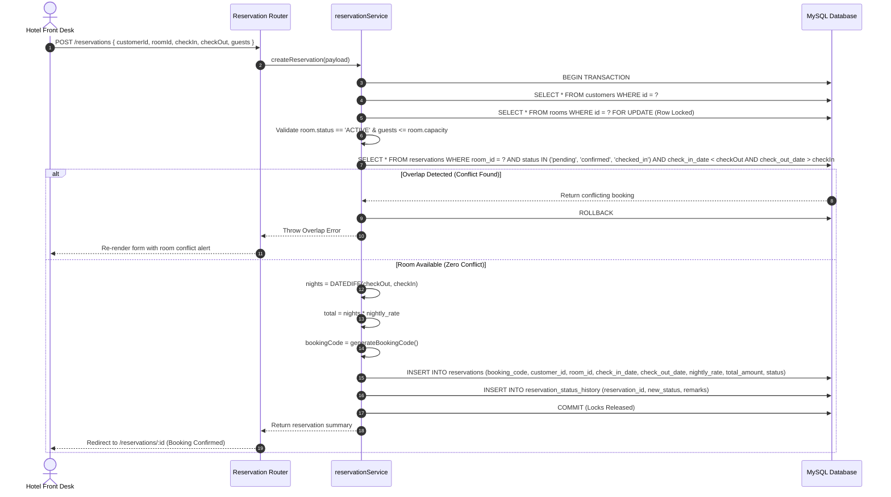
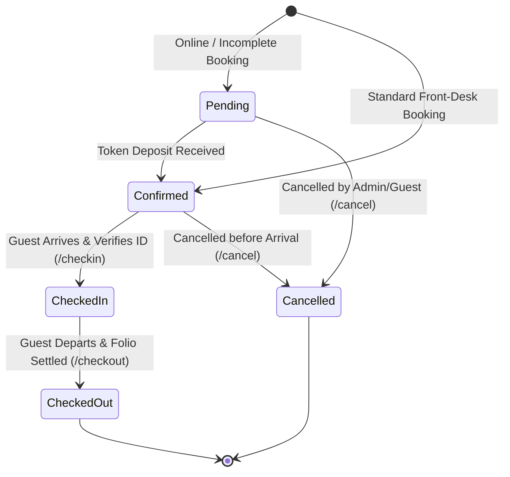
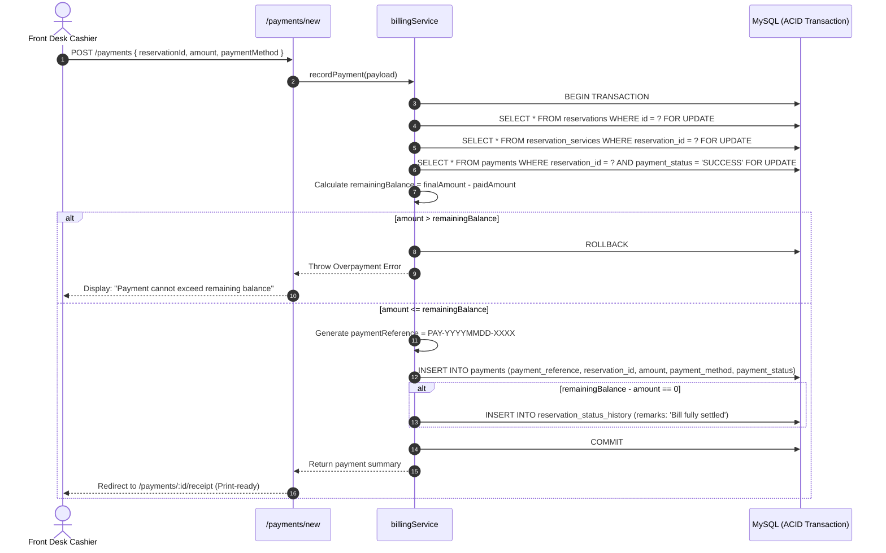
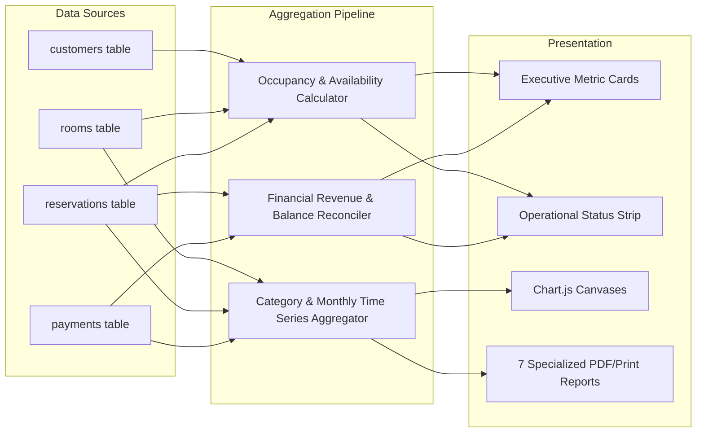

# Hotel Reservation & Management System (HRMS) — System Workflows & Lifecycle Architecture

> **Academic Level:** Master of Computer Applications (MCA) Final Year Project  
> **Architecture:** Model-View-Controller (MVC) using Node.js, Express.js, EJS, and MySQL 8.4 LTS

---

## 📋 Table of Contents
1. [Authentication & Session Lifecycle](#1-authentication--session-lifecycle)
2. [Customer Management Workflow](#2-customer-management-workflow)
3. [Room Inventory Management Workflow](#3-room-inventory-management-workflow)
4. [Reservation & Overlap Prevention Engine](#4-reservation--overlap-prevention-engine)
5. [Guest Front-Desk Check-In & Check-Out](#5-guest-front-desk-check-in--check-out)
6. [Payment Settlement & Itemized Billing](#6-payment-settlement--itemized-billing)
7. [Executive Dashboard & Reporting Pipeline](#7-executive-dashboard--reporting-pipeline)

---

## 1. Authentication & Session Lifecycle

Administrative access to the application is protected by session-based authentication using **bcrypt (10 salt rounds)** and signed, HTTP-only cookies.

```mermaid
sequenceDiagram
    autonumber
    actor Admin as System Administrator
    participant Browser as Web Client
    participant AuthRouter as Express Router (/login)
    participant AuthCtrl as authController
    participant AuthSvc as authService
    participant DB as MySQL (admin_users)
    participant Session as express-session Store

    Admin->>Browser: Enters username & password
    Browser->>AuthRouter: POST /login { username, password }
    AuthRouter->>AuthCtrl: processLogin(req, res)
    AuthCtrl->>AuthSvc: authenticate(username, password)
    AuthSvc->>DB: SELECT admin_id, password_hash FROM admin_users WHERE username = ?
    DB-->>AuthSvc: Return user record
    AuthSvc->>AuthSvc: bcrypt.compare(candidate, storedHash)
    
    alt Password Matches
        AuthSvc-->>AuthCtrl: { success: true, user }
        AuthCtrl->>Session: req.session.regenerate()
        AuthCtrl->>Session: req.session.adminUser = user
        Session-->>AuthCtrl: Session persisted
        AuthCtrl->>Browser: Set-Cookie: hrms_session_id; HttpOnly; SameSite=Lax (302 -> /)
        Browser->>Admin: Displays Executive Dashboard
    else Invalid Credentials
        AuthSvc-->>AuthCtrl: { success: false, message: 'Invalid username or password' }
        AuthCtrl->>Browser: Render auth/login (HTTP 401 with alert)
        Browser->>Admin: Displays error alert
    end
```

---

## 2. Customer Management Workflow

Manages guest profiles with unique phone and email validations. Relational integrity prevents deletion of customers with reservation history.



---

## 3. Room Inventory Management Workflow

Maintains hotel room classifications (**Standard**, **Deluxe**, **Premium**, **Suite**) and operational status (**ACTIVE**, **MAINTENANCE**).



---

## 4. Reservation & Overlap Prevention Engine

The core scheduling engine eliminates double-booking using **InnoDB Row-Level Locking (`SELECT ... FOR UPDATE`)** inside an ACID database transaction.

### Mathematical Overlap Condition
A conflict occurs if an existing reservation satisfies:
$$\text{existing\_check\_in} < \text{requested\_check\_out} \quad \text{AND} \quad \text{existing\_check\_out} > \text{requested\_check\_in}$$



---

## 5. Guest Front-Desk Check-In & Check-Out

Tracks operational status transitions across the booking lifecycle:
$$\text{pending} \longrightarrow \text{confirmed} \longrightarrow \text{checked\_in} \longrightarrow \text{checked\_out}$$



---

## 6. Payment Settlement & Itemized Billing

Financial integrity is enforced strictly on the server:
$$\text{Room Charges} = \text{Nights} \times \text{Nightly Rate}$$
$$\text{Final Amount} = \text{Room Charges} + \text{Additional Services}$$
$$\text{Remaining Balance} = \text{Final Amount} - \sum \text{Successful Payments}$$



---

## 7. Executive Dashboard & Reporting Pipeline

Real-time telemetry and 7 analytical reporting modules queried directly from persistent MySQL data using aggregate functions (`COUNT`, `SUM`, `AVG`, `GROUP BY`).


